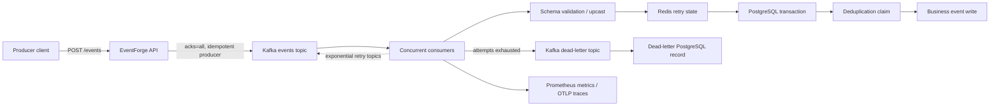

# EventForge

EventForge is a production-minded event ingestion and processing platform built
with Java 21, Spring Boot, Apache Kafka, PostgreSQL, and Redis. It accepts
schema-versioned events, acknowledges them only after Kafka confirms the write,
retries transient failures with exponential backoff, sends exhausted records to
a dead-letter topic, and makes database side effects idempotent.

[](https://github.com/shivanshudwivedi/eventforge/actions/workflows/ci.yml)
[](LICENSE)
[](https://adoptium.net/)

## Why this design

Kafka delivery and a PostgreSQL commit cannot be atomically coordinated without
an additional distributed protocol. EventForge therefore uses an idempotent
consumer pattern:

1. Kafka delivers a record with auto-commit disabled.
2. PostgreSQL inserts its event claim and business record in one transaction.
3. Unique constraints cover `event_id`, `idempotency_key`, and Kafka
   `(topic, partition, offset)`.
4. The listener returns only after the database transaction commits, allowing
   Spring Kafka to advance the consumer offset.
5. If a worker dies after the commit but before the offset is stored, Kafka
   redelivers the record and the database claim turns it into a no-op.

This gives effectively-once PostgreSQL side effects under Kafka redelivery. It
does not make the false claim that Kafka and PostgreSQL share a global
exactly-once transaction.



## Features

- Schema registry with explicit event type/version support and v1 → v2 upcasting
- Kafka producer durability (`acks=all`, idempotence, bounded in-flight requests)
- Idempotent consumers and transactional PostgreSQL writes
- Exponential non-blocking retry topics and a durable dead-letter path
- Redis-backed deterministic failure injection for recovery testing
- Single and batch ingestion APIs with API-key authentication
- Event status lookup for processed and dead-lettered records
- ECS structured logs, Micrometer metrics, health probes, and OTLP tracing
- Multi-stage non-root Docker image and a complete local Compose stack
- Kubernetes deployment, service, HPA, PDB, probes, and hardened container
- k6 load generator targeting 20,000 events/second plus duplicate-write checks
- Unit and PostgreSQL Testcontainers integration tests

## Quick start

Requirements: Docker Engine with Compose. The Maven wrapper is included for
local Java development.

```bash
cp .env.example .env
docker compose up --build -d
docker compose ps
```

Submit an event:

```bash
curl --request POST http://localhost:8080/api/v1/events \
  --header 'Content-Type: application/json' \
  --header 'X-API-Key: local-development-key' \
  --data '{
    "eventType": "order.created",
    "schemaVersion": 1,
    "idempotencyKey": "checkout-8f83b36f",
    "payload": {
      "aggregateId": "order-1001",
      "customerId": "customer-42",
      "amount": 129.99
    },
    "metadata": {"source": "checkout"}
  }'
```

The response is `202 Accepted` after Kafka acknowledges the record. Version 1
`order.created` events are normalized to version 2 by adding `currency: USD`.
Use the returned event ID to query processing state:

```bash
curl --header 'X-API-Key: local-development-key' \
  http://localhost:8080/api/v1/events/REPLACE_WITH_EVENT_ID
```

Stop the stack with `docker compose down`. Add `--volumes` if you intentionally
want to remove local PostgreSQL and Redis data.

## API

| Method | Path | Purpose |
|---|---|---|
| `POST` | `/api/v1/events` | Validate and publish one event |
| `POST` | `/api/v1/events/batch` | Publish 1–1,000 events in one request |
| `GET` | `/api/v1/events/{eventId}` | Return processed or dead-letter status |
| `GET` | `/actuator/health/readiness` | Kubernetes readiness |
| `GET` | `/actuator/prometheus` | Prometheus metrics |

All `/api/**` routes require `X-API-Key`. Actuator health and metrics are kept
outside the authenticated API prefix so cluster probes and a metrics scraper can
reach them; restrict actuator exposure at the network layer in production.

Supported schemas:

| Event type | Accepted versions | Current version | Required payload fields |
|---|---:|---:|---|
| `order.created` | 1, 2 | 2 | `aggregateId`, `customerId`, numeric `amount` |
| `order.cancelled` | 1 | 1 | `aggregateId` |
| `payment.captured` | 1 | 1 | `aggregateId` |

## Retry and failure recovery

Retry topics keep a poison record from blocking its source partition. Defaults
are four total attempts with delays of 250 ms, 500 ms, and 1 s, bounded by 5 s.
After exhaustion, Kafka publishes to `eventforge.events-dlt`; EventForge records
the failure in `dead_letter_events`.

For deterministic local testing:

```bash
EVENTFORGE_FAILURE_INJECTION=true docker compose up --build -d
```

Then add `"metadata": {"injectFailures": "2"}` to an event. A Redis counter
causes its first two processing attempts to fail, after which the same event
succeeds. Set the value at or above the configured attempt count to exercise the
dead-letter path.

Non-blocking retry topics can reorder events for a key while a failed record
waits. Workloads requiring strict per-key ordering should use blocking retries
or partition-specific application semantics instead.

## Testing

```bash
./mvnw test       # fast unit tests
./mvnw verify     # unit + PostgreSQL Testcontainers integration tests
docker compose config
```

The integration test publishes duplicate identities and duplicate Kafka
positions into a real PostgreSQL instance and asserts only one business write.

## Load testing

The included k6 scenario uses the batch endpoint and defaults to a requested
rate of 20,000 events/second:

```bash
docker compose up --build -d
RATE=20000 DURATION=60s make benchmark
make verify-benchmark
```

`RATE` is a requested arrival rate, not a benchmark result. Report throughput
only from a completed run on documented hardware, and include k6 dropped
iterations, API latency, Kafka consumer lag, and the SQL verification output.
See [docs/benchmarking.md](docs/benchmarking.md) for a reproducible protocol.

## Kubernetes

Build and push the image referenced in `k8s/deployment.yaml`, create a real
secret from `k8s/secret.example.yaml`, and apply the manifests:

```bash
kubectl apply -f k8s/configmap.yaml
kubectl apply -f k8s/secret.yaml
kubectl apply -f k8s/deployment.yaml
kubectl apply -f k8s/service.yaml
kubectl apply -f k8s/hpa.yaml
kubectl apply -f k8s/pdb.yaml
```

For queue-depth scaling, replace or supplement the CPU HPA metric with Kafka
consumer lag exposed through KEDA or a Prometheus adapter. Consumer concurrency
is bounded by topic partitions; adding pods beyond the partition count does not
increase consumption parallelism.

## Configuration

Important environment variables:

| Variable | Default | Description |
|---|---|---|
| `EVENTFORGE_API_KEY` | `local-development-key` | API credential; replace in production |
| `KAFKA_BOOTSTRAP_SERVERS` | `localhost:29092` | Kafka brokers |
| `DATABASE_URL` | local PostgreSQL URL | JDBC connection URL |
| `REDIS_HOST` | `localhost` | Redis host |
| `EVENTFORGE_PARTITIONS` | `12` | Source/retry topic partitions |
| `EVENTFORGE_REPLICATION_FACTOR` | `1` | Topic replicas; use 3 in production |
| `EVENTFORGE_RETRY_ATTEMPTS` | `4` | Total delivery attempts |
| `EVENTFORGE_FAILURE_INJECTION` | `false` | Enables deterministic injected failures |
| `TRACING_SAMPLE_RATE` | `1.0` | Local trace sampling probability |

See [application.yml](src/main/resources/application.yml) for the full list.

## Project layout

```text
src/main/java/io/eventforge/
├── config/       # typed configuration, topic creation, API authentication
├── event/        # contracts, schema registry, API, publishing, status
└── processing/   # consumers, retries, deduplication, DLT persistence
src/main/resources/db/migration/  # Flyway schema
benchmarks/                       # k6 scenario and SQL correctness assertion
k8s/                              # production deployment building blocks
observability/                    # local OpenTelemetry Collector config
```

## Security notes

- Never commit `k8s/secret.yaml` or a real `.env`.
- Put TLS and request size limits at the ingress/API gateway.
- Use Kafka SASL/TLS, PostgreSQL TLS, Redis TLS/ACLs, and a secret manager in
  production.
- Restrict `/actuator/prometheus` and health detail to trusted networks.
- Failure injection is disabled by default and should stay disabled outside
  controlled resilience tests.

## License

MIT — see [LICENSE](LICENSE).
